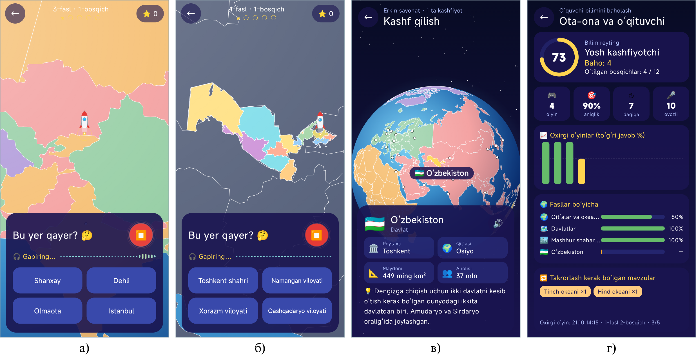
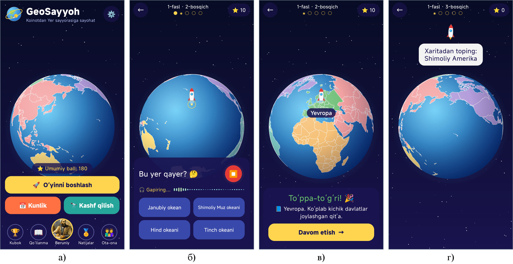
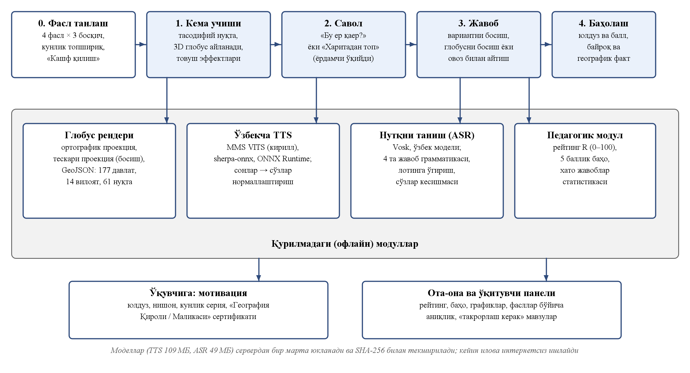

# 🌍 GeoSayyoh

**Geografiya · 6–12 yosh · Android · o‘zbek tilida**

Kosmik kema Yerning tasodifiy nuqtasiga qo‘nadi va so‘raydi: «Bu yer qayer?» — javobni ovoz bilan ayting!

## Ilova haqida

«GeoSayyoh» — 6–12 yoshli o‘quvchilarga jahon va O‘zbekiston geografiyasini o‘yin orqali o‘rgatuvchi ilova. Kosmik kema 3D globusning tasodifiy nuqtasiga qo‘nadi va «Bu yer qayer?» deb so‘raydi, mikrofon o‘zi yoqiladi — bola javobni aytadi yoki variantni bosadi. To‘g‘ri javobdan keyin joy yashil yoritiladi va yordamchi u haqda qiziq ma'lumot aytadi. O‘zbekcha nutq sintezi va tanish telefonning o‘zida, internetsiz ishlaydi.

## Imkoniyatlar

- 4 fasl: qit'alar va okeanlar, 56 davlat, 37 mashhur shahar, O‘zbekiston (14 viloyat)
- 3D globus ortografik proyeksiyada, «Xaritadan top» rejimi
- Javobni ovoz bilan aytish — o‘zbekcha nutqni tanish internetsiz
- «Kashf qilish»: davlatning bayrog‘i, poytaxti, maydoni, aholisi va qiziq fakti
- «Kunlik topshiriq», seriya va «Beruniy lavhasi»
- «Geografiya Qiroli / Malikasi» sertifikati, ota-ona va o‘qituvchi paneli

## O‘yin ssenariysi

1. Globus aylanadi, kosmik kema tasodifiy nuqtaga qo‘nadi
2. «Bu yer qayer?» — bola ovoz bilan javob beradi yoki variant tanlaydi
3. To‘g‘ri javob — joy yoritiladi va qisqa izoh aytiladi
4. 3-bosqich «Xaritadan top» — joyni globusda barmoq bilan topish

## 🏆 Natija

Beshta analog bilan ekspert taqqoslashida **35 balldan 32 ball — 1-o‘rin**.

## O‘rnatish

1. **[geosayyoh.apk](https://github.com/MSoqiy/geosayyoh/raw/main/apk/geosayyoh.apk)** faylini yuklab oling (APK papkasi — [apk/](https://github.com/MSoqiy/geosayyoh/tree/main/apk)).
2. Faylni oching; telefon so‘rasa, «Noma'lum manbalardan o‘rnatish»ga ruxsat bering.
3. «O‘rnatish»ni bosing. Birinchi ishga tushirishda ovoz modellari yuklanadi, keyin ilova internetsiz ishlaydi.

## Ekranlar

## English

**GeoSayyoh** — Geography game for ages 6–12: a spaceship lands on a 3D globe and asks “Where is this place?” — answer by voice in Uzbek. Free, ad-free, works offline. Part of the *Aqlli o‘yin — bilimli avlod* (Smart games — knowledgeable generation) collection of Uzbek educational apps.

---

**Muallif:** Mamasaidov M.A. — Toshkent shahar Mirzo Ulug‘bek markazi o‘qituvchisi · Tetrasoft · ✉ soqiy65@gmail.com · 🌐 https://msoqiy.github.io

**Boshqa ilovalar:** [Otin buvi](https://github.com/MSoqiy/otin-buvi) · [Donish bobo](https://github.com/MSoqiy/donish-bobo) · [Bayon AI](https://github.com/MSoqiy/bayon-ai) · [Tilbilgich En AI](https://github.com/MSoqiy/tilbilgich-en) · [Tilbilgich Fr AI](https://github.com/MSoqiy/tilbilgich-fr) · [Tilbilgich De AI](https://github.com/MSoqiy/tilbilgich-de) · [Tilbilgich Ar AI](https://github.com/MSoqiy/tilbilgich-ar) · [Aljabr](https://github.com/MSoqiy/aljabr)

Kalit so‘zlar: geografiya o‘yini, geografiya bolalar uchun, davlatlar va poytaxtlar, O‘zbekiston viloyatlari, 3D globus, xarita o‘yini, qit'alar va okeanlar, география для детей на узбекском, игра страны и столицы, o‘zbekcha ta'limiy o‘yin, bolalar uchun ilova, android apk
